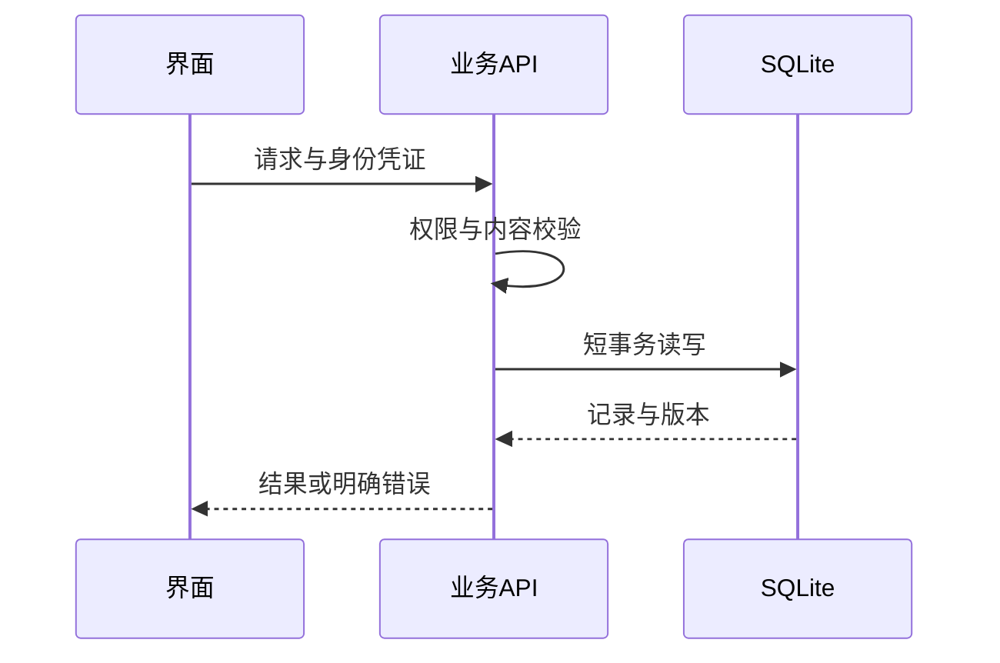

# 系统全景：一份操作如何穿过应用

在笔记里拖动一张图片后，画面已经变了；刷新页面却不一定能找回这次修改。要解释这个差异，需要区分三个时刻：**界面完成编辑、请求通过校验、服务器确认保存**。

以“给架构画板添加图片并保存”为例：图形位置与连线属于笔记结构，图片字节属于素材，浏览器中的选中框属于临时视图。它们出现在同一块屏幕上，却不会写到同一个地方。理解这条数据路径，也就能判断问题发生在编辑器、业务 API，还是持久化阶段。

## 应用调用与两类持久数据

图片和图形位置究竟存在哪里？先看业务用例的两个持久化目标。

```fpl-canvas
system
```

图例：用户图标代表界面，服务器代表正式业务入口；黄色数据库和紫色文件卡片是两个并列的持久化目标。箭头表示用例发起的调用，SQLite 不负责读写素材目录。画板结构进入数据库，画板图片由素材能力管理。

保存画板时，前端提交场景 JSON，其中的图片元素只引用素材 ID。业务用例检查图片归属后保存笔记；素材服务另行管理图片文件。数据库和文件目录是并列目标，所以备份一份数据库并不能自动带走图片。

## 一次业务请求的时序

既然画面变化不是保存完成，界面何时才能显示成功？这取决于正式 API 的确认。



图例：竖线表示参与者，实线箭头是请求，虚线是返回。校验位于事务之前；响应中的版本用于下一次保存。图中省略鉴权中间件和素材 I/O，具体分工见图一。

客户端携带身份和内容发出请求，所属功能执行校验与事务，再把结果交给路由转换成响应。界面收到成功快照后才能更新已保存版本。若响应是错误，保留屏幕上的草稿仍然有价值，它代表用户尚未确认落盘的修改。

## 单机为什么仍要经过业务 API

Future Props Lab 将多个创作应用、模型管理与治理能力放在同一个服务进程和 SQLite 中。这样可以在个人电脑上部署，但账号、Workspace、资源归属和写入版本仍必须逐次验证。浏览器与 Electron 使用同一组正式业务规则，不能因为后端就在本机就省略权限检查。

功能用例拥有自己的文档默认值、事务和错误语义。共享能力提供素材、身份或媒体渲染等明确接口；它们不持有全部应用共用的可变工程对象。这种分工让单个编辑器可以重写，而不牵动每个应用的数据模型。

## 从症状回到出错阶段

画板能移动但保存失败，先检查请求反馈与版本；笔记能打开但图片缺失，先检查素材引用和文件状态；导出失败则检查输出阶段，不应把已保存笔记判定为丢失。外部模型请求属于另一条执行路径，保存普通笔记不需要调用模型。

当前部署边界是单机、多账号和逻辑多 Workspace。思绪工坊知识库是文档容器，不提供模型检索知识库，也没有多实例写入或分布式渲染保证。

> [!TIP]
> 排查一次修改时，分别记录“编辑前版本、保存响应、重新打开后的内容”。这三项比仅查看当前截图更能定位数据在哪一步发生变化。

## 相关阅读

- [保存、历史与并发：防止静默覆盖](/apps/thought-workshop/official-knowledge-bases/technical/documents/revision)
- [素材与导出：引用、快照和包有什么不同](/apps/thought-workshop/official-knowledge-bases/technical/documents/assets)
- [模块边界与路由：为什么按功能拆分](/apps/thought-workshop/official-knowledge-bases/technical/documents/modules)

## 代码入口

1. `backend/app/main.py`
2. `backend/app/api.py`
3. `docs/architecture/project-layout.md`
