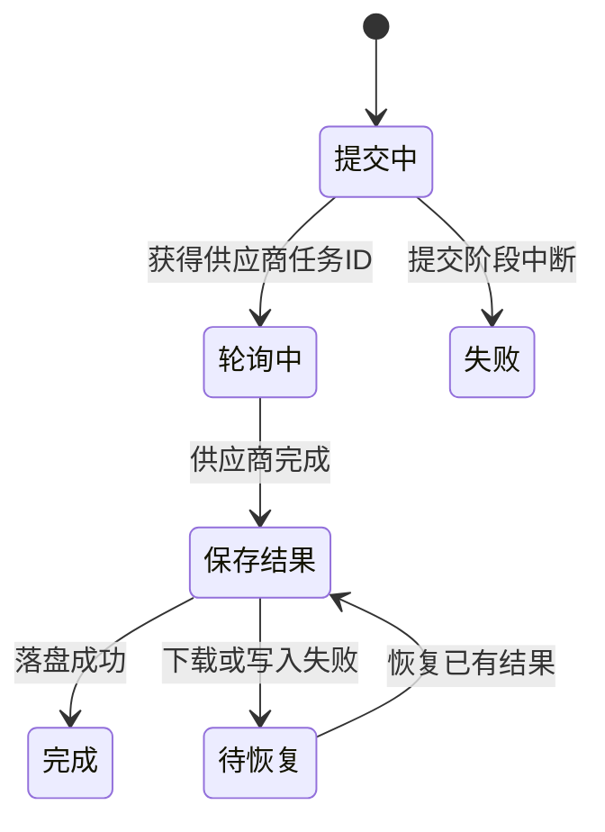

# 后台任务与恢复

同样显示“生成失败”，背后可能是两件事：供应商有没有接单无法确认，或者视频已经完成、只是在下载时断网。前者再次提交可能重复计费，后者应尽量取回已有结果。

后台任务因此需要保存比进度百分比更多的信息：当前阶段、供应商任务 ID、结果地址、账号和错误。这里以视频生成说明驱动器如何利用这些事实决定下一步。

## 统一驱动器与业务钩子

应用自己的任务记录，与公共驱动器各自决定什么？

```fpl-canvas
tasks
```

图例：驱动器负责何时执行，业务钩子负责如何存取自身记录；右侧区分外部任务与本地结果。箭头是职责调用，不表示网络请求位于数据库写事务内。

应用提供任务存取、素材落盘和日志等钩子，GenerationTaskDriver 决定调用顺序。供应商提交和轮询位于外部步骤，本地结算负责把结果变成可引用素材。把状态编排集中起来，可以避免不同工坊在中断后采用相反的重试策略。

## 异步任务的恢复边界

从提交到落盘，哪一个边界让“重试”改变了含义？



图例：状态箭头标注进入下一阶段的条件。“待恢复”是结果下载失败的概念阶段，不保证各应用都以这个字符串存储。提交阶段中断走失败分支，不回到自动提交。

提交阶段可能还没有保存供应商任务 ID；重启后无法据此证明服务没有接单，因此 submitting 会安全失败。已有结果地址则提供了另一种恢复依据：当记录处于处理结果阶段，可以继续落盘，而不必新建供应商任务。图中的“待恢复”是概念说明，不是所有应用共同保存的状态字符串。

## 进度 100% 仍可能没有可用文件

驱动器取得任务时恢复明确的账号。排队任务通过条件更新进入 submitting，取得供应商任务 ID 后转入 pending；轮询根据结果更新状态。供应商完成时先记录结果地址并进入 materializing 语义，再执行下载与素材结算。

当前存储实现可能在结果落盘阶段仍使用 processing，并把进度设为 100。因此消费者应该检查终态及结果引用，不能仅凭进度条决定“文件已就绪”。

## 失败恢复要沿已有身份继续

若任务有供应商 ID，可据此判断已有执行；若还保留结果地址，可使用所属功能提供的恢复操作重新处理已有结果。恢复入口仍要验证状态和权限，不能手工把数据库状态改回 queued。

网络等待期间不占用长写事务；准备与结算各自使用短事务。测试需要覆盖排队竞争、提交中断、供应商失败、完成但缺结果地址，以及下载或写入失败。当前实现没有“任何失败都自动重提”的保证。

> [!WARNING]
> 提交结果不明时，不要把旧任务改回排队状态。保留任务与错误信息，先核对供应商执行情况；重新生成应是一次明确的新操作。

## 一次图片生成的数据生命周期

视觉工坊生成用例先验证节点输入、素材归属和模型能力，建立应用自己的任务记录；驱动器通过任务存取钩子认领工作，再把明确输入交给供应商。记录得到供应商 ID 后可继续轮询，得到结果地址后才能进入本地结算。结果素材形成之后，页面才拥有可复用产物。

任务快照、外部 ID 和本地素材分别表达意图、执行和结果。修改画布不应重放收费提交，也不应悄悄改变已提交请求。后台用任务账号组装素材，不依赖发起页面仍然打开。

## 恢复和重试按阶段判断

排队竞争需要条件认领；提交中断要安全失败；结果下载失败可按正式入口恢复已有结果。完成但缺地址、素材落盘异常和日志结算失败都需要独立反馈。测试这些边界，才能证明“再次点击”没有被实现成所有阶段都自动重新提交。

## 相关阅读

- [供应商适配与流式推理](/apps/thought-workshop/official-knowledge-bases/technical/documents/providers)
- [视觉创作工坊：节点图与生成任务](/apps/thought-workshop/official-knowledge-bases/technical/documents/visual-workshop)
- [调用日志与排查](/apps/thought-workshop/official-knowledge-bases/general/documents/logs)
- [后端功能切片与用例边界](/apps/thought-workshop/official-knowledge-bases/technical/documents/backend-design)

## 代码入口

1. `backend/app/llm/generation_runtime/driver.py`
2. `backend/app/llm/generation_runtime/media.py`
3. `backend/studio/apps/visual_workshop/website/generation_runner.py`
