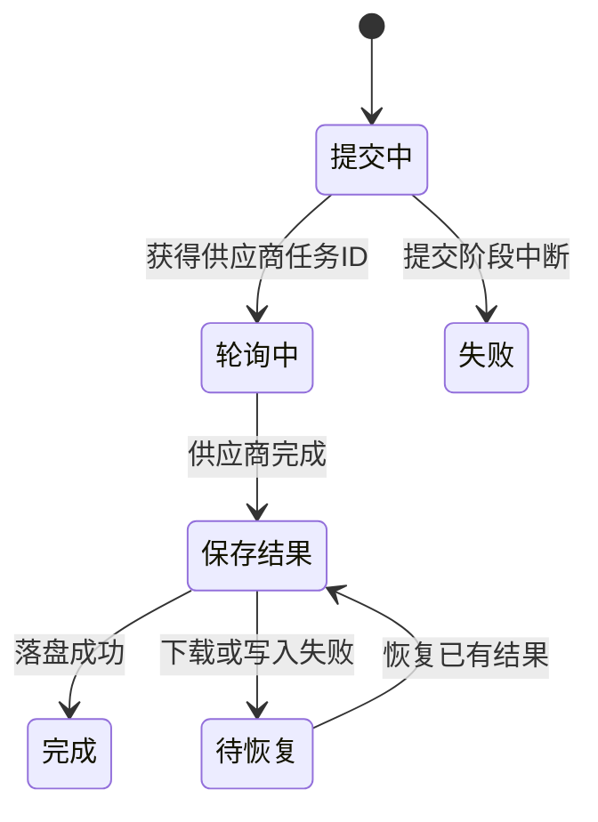

# 后台任务：提交中断与结果恢复

## 先理解它解决什么问题

图片与视频生成通常跨越多次请求。任务记录保存提交阶段、供应商任务身份和结果落盘状态，驱动器依据当前状态决定下一步，不能把所有错误都当作重新生成。

**贯穿实例：** 视频已由供应商生成，但下载结果时失败。恢复应优先再次取得已有结果；如果在提交时断电且不知道供应商是否接单，自动重新提交可能重复计费。

## 图一：统一驱动器与业务钩子

```fpl-canvas
tasks
```

图例：驱动器负责何时执行，业务钩子负责如何存取自身记录；右侧区分外部任务与本地结果。箭头是职责调用，不表示网络请求位于数据库写事务内。

## 图二：异步任务的恢复边界



图例：状态箭头标注进入下一阶段的条件。“待恢复”是结果下载失败的概念阶段，不保证各应用都以这个字符串存储。提交阶段中断走失败分支，不回到自动提交。

## 实现与设计取舍

GenerationTaskDriver 统一编排状态，各业务提供任务存取、素材组装和结算钩子。网络等待发生在短事务之间。任务上下文显式保存 Workspace，重启后从任务恢复身份，不依赖已经结束的 HTTP 请求。

## 异常、验证与当前边界

图中状态是概念阶段，具体字符串以任务 schema 为准。submitting 中断安全失败，不自动重提供应商。轮询恢复与创建新任务需要区分；界面只看到百分比不证明文件已经可用。测试要覆盖提交中断、轮询失败和结果下载恢复。

## 代码入口与阅读顺序

1. `backend/app/llm/generation_runtime/driver.py`
2. `backend/app/llm/generation_runtime/media.py`
3. `backend/app/apps/visual_workshop/generation_runner.py`

阅读时先定位输入和校验，再跟踪持久化或执行入口，最后对照输出与错误分支。可以把上方图复制到个人知识库加入自己的注释；副本不会随官方文章自动更新。
