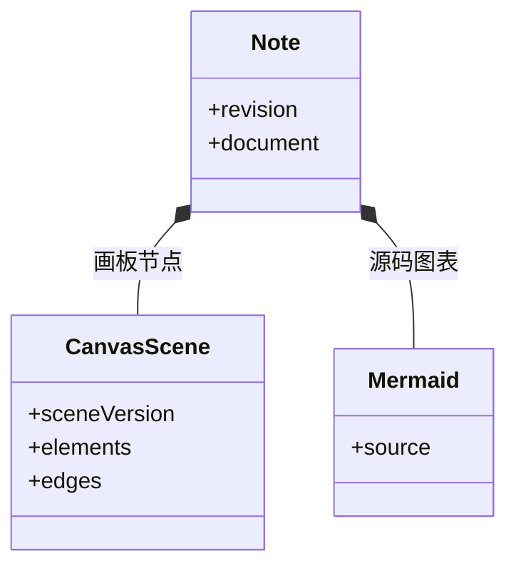

# 思绪工坊：富文本、画板与知识库

## 先理解它解决什么问题

知识库组织文档，文档以受支持的富文本节点树保存。画板是其中一个原子节点，内部包含可编辑的场景数据；Mermaid 节点保存源码。官方库属于随版本发布的静态内容，没有个人项目记录。

**贯穿实例：** 在一篇笔记插入架构画板，移动图形后保存，再导出完整备份并重新导入。新笔记应保留元素、连线与图片引用，而不是只剩一张截图。

## 图一：两类知识库与可编辑笔记的边界

```fpl-canvas
thought-workshop
```

图例：上排是官方静态阅读与显式复制，下排是个人数据保存。复制出的内容成为下排的新笔记，官方库本身仍没有 SQLite 项目。画板预览与画板场景是同一内容的不同表现。

## 图二：笔记内的两种图表节点



图例：实心菱形表示笔记包含图表节点。CanvasScene 保存元素与连线，Mermaid 保存源码；两者没有自动互转关系，revision 仍由笔记保存流程管理。

## 实现与设计取舍

后端仅接受允许的节点、属性和嵌套关系，提取可搜索文本与素材引用。CanvasScene 是独立的版本化格式，React Flow 的选中、测量和视口状态不成为持久事实。阅读与导出共用图形语义；笔记继续复用 CAS、自动保存和历史恢复。

## 异常、验证与当前边界

图形有误只影响该图的反馈，不执行原始 HTML。Markdown 画板源码块需要本应用解释；PNG 导出适合展示，完整备份适合继续编辑。画板首版侧重技术信息图，不包含实时多人协作、自由画笔或 Mermaid 与画板自动互转。

## 代码入口与阅读顺序

1. `backend/app/apps/thought_workshop/schemas/document.py`
2. `web/src/features/thought-workshop/diagrams/model.ts`
3. `web/src/features/thought-workshop/diagrams/CanvasEditor.tsx`

阅读时先定位输入和校验，再跟踪持久化或执行入口，最后对照输出与错误分支。可以把上方图复制到个人知识库加入自己的注释；副本不会随官方文章自动更新。
