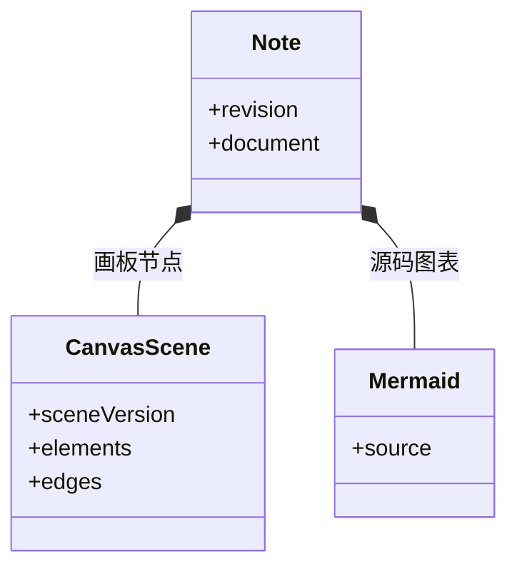
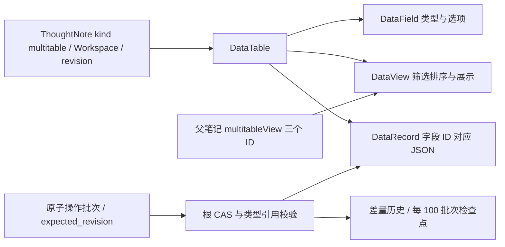

# 思绪工坊：富文本、画板与知识库

管理员将现有官方指南导入自己的知识库，调整架构图，再导出并重新导入。如何保证拿回来的仍是一张能编辑的图，而不是截图？关键在于保存内容的结构。

笔记保存受支持的富文本节点树。Mermaid 节点保存源码，canvas 节点保存场景元素与连线；它们都属于笔记正文。官方文档也属于同一笔记记录，由管理员显式发布并标记官方；只读、可见范围与编辑授权分别保存。

## 笔记存储与发布权限的边界

同一笔记进入私人入口和社区入口时，如何使用不同权限却保持同一正文与历史？

```fpl-canvas
thought-workshop
```

图例：上排是发布属性、社区阅读与有效授权，下排是 Workspace 笔记和保存历史。社区写入在授权后进入同一正文用例；官方标记不创建第二份正文。画板预览与场景是同一内容的不同表现。

管理员主动导入时，普通备份用例一次事务创建知识库、正文、目录和跨库引用，来源映射及操作回执与笔记一起提交。中断后先读取回执，成功请求返回原结果；再次主动导入使用新请求，创建独立副本。发布只引用当前笔记，不复制内容，应用升级不会覆盖管理员修改。

## 笔记内的两种图表节点

画板内部有自己的版本，为什么还要复用笔记 revision？



图例：实心菱形表示笔记包含图表节点。CanvasScene 保存元素与连线，Mermaid 保存源码；两者没有自动互转关系，revision 仍由笔记保存流程管理。

场景版本 sceneVersion 说明如何解析元素与连线，笔记 revision 说明这次写入基于哪个已保存状态。两者回答不同问题。画板作为原子节点加入正文，继续接受笔记统一的 CAS、历史和未保存保护，不另开一条可覆盖旧正文的保存通道。

正文 schema version 3 新增稳定文档引用和五类提示块，读取兼容 version 2。CanvasScene version 2 保存字号、文字对齐与四侧连接锚点，读取 version 1 时采用默认布局；编辑、预览和 SVG 导出使用同一确定性连线几何。上图的版本字段用于内容格式迁移，revision 则继续守住写入并发。

引用索引在正文保存、历史还原与导入的事务中同步更新；重命名或移动不会改变目标 ID。模板是 Workspace 独立快照，子树复制校验来源目录、逐篇版本和目标库版本，并在一次事务中重映射内部引用。个人筛选与阅读位置另按账号隔离，不改正文版本，也不进入知识库备份。整库导出先取得 SQLite 一致读快照，再由 Web 渲染图形并打包相对链接。

## 只把编辑结果写入场景

移动结束、调整尺寸、修改样式或文字会改变 CanvasScene；选中状态、测量结果和视口缩放只服务编辑器，不持久化为正文。React Flow 是交互实现，独立场景格式则是阅读、保存与导出之间的契约。

后端验证允许的图形、属性、连接端点与分组关系，并提取图中文字用于搜索、提取图片 ID 用于素材追踪。画板中的图片因此与普通正文图片一样受到归属和删除引用检查。

## 从错误恢复，而不是把图转成图片掩盖问题

Mermaid 语法错误保留源码供修改；画板格式无效则显示读取问题，不执行原始 HTML 或任意脚本。保存失败时保留草稿，恢复历史也以当前笔记版本重新提交。

复制到其他知识库或通过 HTML 剪贴板迁移时，图片需要可读取的字节与新引用。迁移数据缺失不能直接复用来源 ID。完整备份保留编辑数据；Markdown 的 fpl-canvas 块可往返导入；PNG/SVG 用于交付视觉结果。

当前画板面向技术信息图，不提供自由画笔、实时共同编辑或 Mermaid 与画板的自动互转。

> [!NOTE]
> 缩放图表不会产生正文历史。若想保留某种布局，需要修改元素位置或尺寸；仅平移到另一个观察位置并不构成笔记内容变化。

## 富文本、草稿和目录各有生命周期

编辑器回传正文树，useNoteDraft 拥有在途保存、编辑代次与本机恢复；Notes 拥有服务器正文 CAS、引用索引和历史。目录移动由知识库目录操作处理，普通正文保存不能改变归属。个人阅读位置只影响再次打开时的阅读体验，不应让一篇笔记产生新的正文历史。

一次含图保存先获得素材 ID，再编辑场景并提交正文。后端校验图片为本空间公共文件，同一事务维护内容和引用；浏览器只按成功快照推进版本。图片读取失败保留场景，保存失败保留草稿；本机恢复副本与服务器历史分开处理。

## 文章、图形与笔记的闭环验证

官方指南通过管理员主动导入，再经普通发布 API 设置官方标记。验证导入后可以编辑、保存、刷新和备份，未发布时旧地址不泄露私人内容；验证菜单打开不重挂载图形、不复位视口。Notes、useNoteDraft 和 portability 分别提供业务、客户端状态与迁移入口，而 CanvasScene 保持独立于 React Flow 的持久化契约。

## 社区发布保持原文与授权边界

知识社区 `publication/` 保存发布记录、逐篇角色和收藏，不复制 ThoughtNote。跨空间读者只取得当前可读正文、过滤目录与实际引用素材；编辑器通过 DocumentAccess 适配器调用社区 API，原库编辑调用普通 API，最后都进入 Notes 的版本校验和历史事务。社区不提供新建、移动、回收站或历史恢复入口。

源回收站事务同步撤回文章，恢复不自动发布；整库撤回保留正文和配置。权限配置同样使用 revision，冲突先显示错误、保留选择，再由用户明确重新载入。客户端草稿和缓存按账号与发布资源隔离，权限失效停止保存而不自动覆盖。

## 正文编排与访问适配

`document-layout/` 拥有卡片、卡片组、动态目录、代码工具和共用正文样式。导入包把 Markdown、图形和首页转换为标准 JSON 块；导入后的官方文章直接使用普通阅读组件，访问适配器区分 Workspace 与社区权限。父子文档树统一呈现目录，不使用专用分组侧栏。

卡片只保存引用标识和展示配置，目标标题与简介经 DocumentAccess 按当前账号解析；动态目录绑定当前知识库。社区的访问适配器只读取当前发布记录的可见目录。新节点进入原 Notes 校验、CAS、历史、引用索引和备份，不需要 SQL schema 变更，CanvasScene 契约不变。失效目标不渲染标题或链接；HTML 与 Markdown 导出也按当前可见目标投影。

## 多维表格的根、实体与视图

一个项目任务文档可以同时呈现网格、按状态分栏的看板和按截止日期排列的月历。三者读取同一批记录；视图只保存配置，筛选和隐藏列不构成权限。



图例：根拥有租户和生命周期，表拥有字段、视图与记录；嵌入只引用视图，不持有数据副本。操作批次在短事务内同步实体、历史和素材引用；正文保存不能覆盖独立表格。800ms 合并、串行传输和 IndexedDB 恢复由表格编辑器拥有，CAS 冲突停止自动提交。

创建、CSV 导入和还原建立完整检查点，其他批次保存实体前后值。恢复由最近检查点重建，再作为新 revision 提交。version 7 备份保存全部结构和历史；复制及模板应用重映射内部 ID。每表 5,000 条记录、50 字段的边界配合服务端受控 JSON 查询和 Web 虚拟滚动，仍使用同一 SQLite 与进程。

社区读取嵌入先校验父文章及实际引用，再独立校验目标表格角色。隐藏笔记引用不解析标题，附件逐次检查表格当前引用；历史附件留在源 Workspace 的恢复边界。首版不支持公式、跨表关联、汇总、成员字段、Excel、自动化或实时协同。

## 相关阅读

- [编辑、保存、历史与并发](/apps/thought-workshop/official-knowledge-bases/technical/documents/revision)
- [素材上传、引用与预览](/apps/thought-workshop/official-knowledge-bases/technical/documents/assets)
- [思绪工坊：主要操作流程](/apps/thought-workshop/official-knowledge-bases/thought-workshop/documents/workflow)
- [组件契约与生命周期](/apps/thought-workshop/official-knowledge-bases/technical/documents/component-contracts)

## 代码入口

1. `backend/app/apps/thought_workshop/schemas/document.py`
2. `web/src/features/thought-workshop/diagrams/model.ts`
3. `web/src/features/thought-workshop/diagrams/CanvasEditor.tsx`
