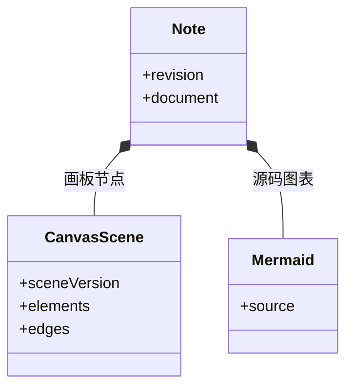

# 思绪工坊：富文本、画板与知识库

把官方架构图复制进自己的知识库，加上两个节点，再导出并重新导入。如何保证拿回来的仍是一张能编辑的图，而不是截图？关键在于保存内容的结构。

笔记保存受支持的富文本节点树。Mermaid 节点保存源码，canvas 节点保存场景元素与连线；它们都属于笔记正文。官方库则是随版本发布的静态阅读资源，复制操作才会创建个人数据。

## 两类知识库与可编辑笔记的边界

官方图与个人图看起来相同，为什么只有个人副本进入保存和历史？

```fpl-canvas
thought-workshop
```

图例：上排是官方静态阅读与显式复制，下排是个人数据保存。复制出的内容成为下排的新笔记，官方库本身仍没有 SQLite 项目。画板预览与画板场景是同一内容的不同表现。

上排读取打包的 Markdown 与图形，下排处理 Workspace 中的个人记录。点击复制时，场景或源码与原文链接被写进新笔记；官方原图不会因为用户修改副本而变化，也不会随用户备份被导出成一个官方项目。

## 笔记内的两种图表节点

画板内部有自己的版本，为什么还要复用笔记 revision？



图例：实心菱形表示笔记包含图表节点。CanvasScene 保存元素与连线，Mermaid 保存源码；两者没有自动互转关系，revision 仍由笔记保存流程管理。

场景版本 sceneVersion 说明如何解析元素与连线，笔记 revision 说明这次写入基于哪个已保存状态。两者回答不同问题。画板作为原子节点加入正文，继续接受笔记统一的 CAS、历史和未保存保护，不另开一条可覆盖旧正文的保存通道。

正文 schema version 3 新增稳定文档引用和五类提示块，读取兼容 version 2。CanvasScene version 2 保存字号、文字对齐与四侧连接锚点，读取 version 1 时采用默认布局；编辑、预览和 SVG 导出使用同一确定性连线几何。上图的版本字段用于内容格式迁移，revision 则继续守住写入并发。

引用索引在正文保存、历史还原与导入的事务中同步更新；重命名或移动不会改变目标 ID。模板是 Workspace 独立快照，子树复制校验来源目录、逐篇版本和目标库版本，并在一次事务中重映射内部引用。个人筛选与阅读位置另按账号隔离，不改正文版本，也不进入知识库备份。整库导出先取得 SQLite 一致读快照，再由 Web 渲染图形并打包相对链接。

## 只把编辑结果写入场景

移动结束、调整尺寸、修改样式或文字会改变 CanvasScene；选中状态、测量结果和视口缩放只服务编辑器，不持久化为正文。React Flow 是交互实现，独立场景格式则是阅读、保存与导出之间的契约。

后端验证允许的图形、属性、连接端点与分组关系，并提取图中文字用于搜索、提取图片 ID 用于素材追踪。画板中的图片因此与普通正文图片一样受到归属和删除引用检查。

## 从错误恢复，而不是把图转成图片掩盖问题

Mermaid 语法错误保留源码供修改；画板格式无效则显示读取问题，不执行原始 HTML 或任意脚本。保存失败时保留草稿，恢复历史也以当前笔记版本重新提交。

复制到其他知识库或通过 HTML 剪贴板迁移时，图片需要可读取的字节与新引用。迁移数据缺失不能直接复用来源 ID。完整备份保留编辑数据；Markdown 的 fpl-canvas 块可往返导入；PNG/SVG 用于交付视觉结果。

当前画板面向技术信息图，不提供自由画笔、实时共同编辑或 Mermaid 与画板的自动互转。

> [!NOTE]
> 缩放图表不会产生正文历史。若想保留某种布局，需要修改元素位置或尺寸；仅平移到另一个观察位置并不构成笔记内容变化。

## 相关阅读

- [保存、历史与并发：防止静默覆盖](/apps/thought-workshop/official-knowledge-bases/technical/documents/revision)
- [素材与导出：引用、快照和包有什么不同](/apps/thought-workshop/official-knowledge-bases/technical/documents/assets)
- [思绪工坊：主要操作流程](/apps/thought-workshop/official-knowledge-bases/thought-workshop/documents/workflow)

## 代码入口

1. `backend/app/apps/thought_workshop/schemas/document.py`
2. `web/src/features/thought-workshop/diagrams/model.ts`
3. `web/src/features/thought-workshop/diagrams/CanvasEditor.tsx`
