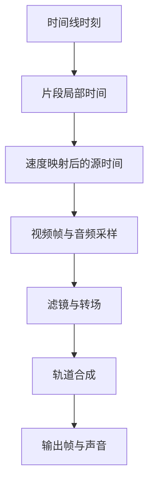

# 视频剪辑：多轨、速度与接缝

一段素材从源文件第 3 秒开始取用，放在时间线第 10 秒，并以两倍速播放。当播放头来到时间线第 12 秒时，应该显示源文件哪一帧？答案是第 7 秒，而不是第 12 秒或第 2 秒。

这个小例子对应剪辑器中最容易混淆的三项数据：时间线位置、片段局部时间、素材源时间。裁切、移动和波纹删除改变的字段不同，只有先区分坐标，才能让预览、导出与撤销保持一致。

## 三个时间坐标与一段变速片段

从时间线上的 12 秒到素材中的 7 秒，中间经过哪些运算？

```fpl-canvas
video-editor
```

图例：上方三张卡是同一播放位置在不同坐标系中的数值，T 不是源文件时间；下方三张卡是同一精确空隙的显式处理选择，箭头表示按所选方式规划，独立音乐字幕的位置不随前移改变。变速曲线需要积分或对应映射实现，不能继续套用此恒速公式；定帧的源取样精度与填补区间精度见图底边界。

先减去片段起点：12 − 10 = 2 秒；再乘以恒定播放速率并加源内点：3 + 2 × 2 = 7 秒。当前公共源时间函数使用微秒并对乘积向下取整。这个计算说明移动片段不必改变源内点，裁切和速度变化则需要重新检查源区间。

## 从时间到音画合成

得到源时间后，一帧画面和声音还要经过哪些处理？



图例：方框表示时间映射、采样、效果和合成的阶段。多个轨道可以同时贡献画面与声音；流程箭头表达依赖顺序，不表示只有一条轨道。

采样之后还有效果、转场和多轨合成。转场可能让相邻片段同时参与输出，音轨也有自己的采样与混合规则。仅验证单片段中间一帧正确，不能证明接缝和声音没有偏移。

## 编辑操作改变的是工程描述

工程保留轨道、片段身份、源引用、时间区间及关联。把片段拖到更晚的位置主要改变时间线起点；缩短片段会改变可见区间；波纹删除则还要移动后续片段。关联片段、音频接缝和转场引用要一起保持有效。

后端时间线用例对操作后的文档进行校验和版本控制。公共媒体能力执行源时间映射与渲染，视频编辑器自己的项目逻辑不应成为其他应用直接导出的内部依赖。

## 49.707 毫秒的空隙怎样精确闭合

左片段在 1,000,003 微秒结束，右片段在 1,049,710 微秒开始，差值为 49,707 微秒。它在 30 FPS 下约为 1.49 帧、60 FPS 下约为 2.98 帧；检测和编辑仍直接使用微秒边界，精确接点不报错，不再次取整到帧网格。

`timelineGaps.ts` 只计算可见视觉轨和混合轨的画面覆盖；文字不覆盖画面空隙，其他轨道也不抹掉该轨的结果。纯字幕、音频、隐藏轨和首尾留白排除。纯黑片段、图片定帧以及源素材黑帧已经有画面覆盖，不属于空隙。

`gapEditPlan.ts` 以当前时间线和素材元数据一次规划最终状态。延长模式把左片段及关联媒体的 durationUs 增加 49,707，保持源入点、速度和所有后续起点；按速度检查每个关联源的剩余长度。前移模式累计所选空隙，把同轨后续片段与关联媒体的起点减去累计值，未选间隔保持原时长。多轨先统一关联组请求，再校验锁定、负时间、重叠与画面转场，不能按轨依次写入产生半完成状态。

`gapFreeze.ts` 在显式定帧模式下取左片段末尾源帧，新增覆盖 [1,000,003, 1,049,710) 的静音图片，固定末尾变换并清空动画和转场，不合成其他轨道。源帧 API 按毫秒取样并缩放到宽度不超过 1920；时间线图片区间保持微秒精度。源末尾黑帧仍可能被定住。图片和纯色直接复用；视频先通过现有提帧与素材上传 API 准备 PNG，再一次提交时间线。准备取消、失败或撤销可能保留未使用素材，时间线不会部分写入。

延长与前移复用 `restoreClipStates`，定帧使用既有 `addClip` / `removeClip` 逆操作；整批对应一次撤销。音频转场协调统一维护有效重叠与逆操作。面板选择和筛选只在界面保存；版本或素材变化清除失效选择，提交时再次核对。CAS 409 或保存失败暂停队列，不自动重试，没有新增 HTTP 接口、持久字段或迁移。

## 先检查边界，再检查整段播放

| 现象                     | 优先核对                       |
| ------------------------ | ------------------------------ |
| 移动后显示了错误素材位置 | 时间线起点是否误改成源内点     |
| 变速后尾部不足或声音错位 | 源区间、播放速率与音频处理     |
| 波纹删除后出现断口       | 后续片段位置、关联与接缝       |
| 撤销后仍有残留变化       | 片段身份、原区间与转场记录     |
| 检查无空隙却仍闪黑       | 源素材内部黑帧、纯黑片段与转场 |

当前源采样例子基于恒定 playback_rate。不要把图中的公式理解为已经实现任意变速曲线；更复杂的速度模型需要专门的时间映射契约。导出前还应预检素材、字幕字体和效果支持，当前渲染在单机完成。

> [!TIP]
> 为一个编辑操作留下“前后区间 + 源内点 + 速率”四项对照。撤销后应恢复这些精确数据，而不只是看起来回到差不多的位置。

## 剪辑状态怎样进入确定性渲染任务

前端时间线编辑产生轨道与片段描述，timeline 用例校验并保存版本；播放头、选中片段和吸附提示留在界面。timelineSaveQueue 协调编辑提交，不能让旧响应覆盖后来拖动。公共 speed 与 timeline_document 表达源时间语义，不读取播放器内部状态作为成片依据。

导出先预检 expectedRevision、素材 ready 状态、区间和 preset。指纹覆盖文档、版本与素材信息；任务创建拒绝过期预检，保存 snapshot_document 与请求参数。request_id 识别同一提交，后续编辑属于新工程状态，不自动更新既有任务快照。

## 用精确时间与输出片段检查恢复

检查两倍速例子的第 7 秒源位置、裁切首尾、波纹删除关联和音频接缝，再检查预检后改动被发现、素材未就绪拒绝及部分输出不当成完整视频。时间线保存成功与导出成功是两个确认点；输出失败保留原工程，先修输入和依赖，不反复覆盖时间线字段。

## 相关阅读

- [时间线与媒体渲染](/apps/thought-workshop/official-knowledge-bases/technical/documents/rendering)
- [编辑、保存、历史与并发](/apps/thought-workshop/official-knowledge-bases/technical/documents/revision)
- [视频剪辑工坊：主要操作流程](/apps/thought-workshop/official-knowledge-bases/video-editor/documents/workflow)
- [导入、备份与导出](/apps/thought-workshop/official-knowledge-bases/technical/documents/data-exchange)

## 代码入口

1. `backend/app/apps/video_editor/timeline.py`
2. `backend/app/capabilities/media_rendering/speed.py`
3. `backend/app/capabilities/media_rendering/timeline_document.py`
4. `web/src/features/video-editor/timelineGaps.ts`
5. `web/src/features/video-editor/gapEditPlan.ts` 与 `gapFreeze.ts`
