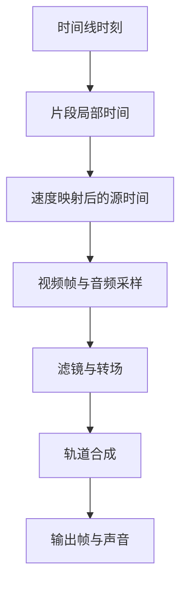

# 视频剪辑：多轨、速度与接缝

一段素材从源文件第 3 秒开始取用，放在时间线第 10 秒，并以两倍速播放。当播放头来到时间线第 12 秒时，应该显示源文件哪一帧？答案是第 7 秒，而不是第 12 秒或第 2 秒。

这个小例子对应剪辑器中最容易混淆的三项数据：时间线位置、片段局部时间、素材源时间。裁切、移动和波纹删除改变的字段不同，只有先区分坐标，才能让预览、导出与撤销保持一致。

## 三个时间坐标与一段变速片段

从时间线上的 12 秒到素材中的 7 秒，中间经过哪些运算？

```fpl-canvas
video-editor
```

图例：三张卡是同一播放位置在不同坐标系中的数值，T 不是源文件时间。下方注明计算前提；变速曲线需要积分或对应映射实现，不能继续套用此恒速公式。

先减去片段起点：12 − 10 = 2 秒；再乘以恒定播放速率并加源内点：3 + 2 × 2 = 7 秒。当前公共源时间函数使用微秒并对乘积向下取整。这个计算说明移动片段不必改变源内点，裁切和速度变化则需要重新检查源区间。

## 从时间到音画合成

得到源时间后，一帧画面和声音还要经过哪些处理？



图例：方框表示时间映射、采样、效果和合成的阶段。多个轨道可以同时贡献画面与声音；流程箭头表达依赖顺序，不表示只有一条轨道。

采样之后还有效果、转场和多轨合成。转场可能让相邻片段同时参与输出，音轨也有自己的采样与混合规则。仅验证单片段中间一帧正确，不能证明接缝和声音没有偏移。

## 编辑操作改变的是工程描述

工程保留轨道、片段身份、源引用、时间区间及关联。把片段拖到更晚的位置主要改变时间线起点；缩短片段会改变可见区间；波纹删除则还要移动后续片段。关联片段、音频接缝和转场引用要一起保持有效。

后端时间线用例对操作后的文档进行校验和版本控制。公共媒体能力执行源时间映射与渲染，视频编辑器自己的项目逻辑不应成为其他应用直接导出的内部依赖。

## 先检查边界，再检查整段播放

| 现象                     | 优先核对                   |
| ------------------------ | -------------------------- |
| 移动后显示了错误素材位置 | 时间线起点是否误改成源内点 |
| 变速后尾部不足或声音错位 | 源区间、播放速率与音频处理 |
| 波纹删除后出现断口       | 后续片段位置、关联与接缝   |
| 撤销后仍有残留变化       | 片段身份、原区间与转场记录 |

当前源采样例子基于恒定 playback_rate。不要把图中的公式理解为已经实现任意变速曲线；更复杂的速度模型需要专门的时间映射契约。导出前还应预检素材、字幕字体和效果支持，当前渲染在单机完成。

> [!TIP]
> 为一个编辑操作留下“前后区间 + 源内点 + 速率”四项对照。撤销后应恢复这些精确数据，而不只是看起来回到差不多的位置。

## 相关阅读

- [时间线与媒体渲染：从状态到帧](/apps/thought-workshop/official-knowledge-bases/technical/documents/rendering)
- [保存、历史与并发：防止静默覆盖](/apps/thought-workshop/official-knowledge-bases/technical/documents/revision)
- [视频剪辑工坊：主要操作流程](/apps/thought-workshop/official-knowledge-bases/video-editor/documents/workflow)

## 代码入口

1. `backend/app/apps/video_editor/timeline.py`
2. `backend/app/capabilities/media_rendering/speed.py`
3. `backend/app/capabilities/media_rendering/timeline_document.py`
