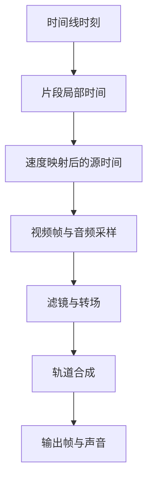

# 视频剪辑：多轨、速度与接缝

一段素材从源文件第 3 秒开始取用，放在时间线第 10 秒，并以两倍速播放。当播放头来到时间线第 12 秒时，应该显示源文件哪一帧？答案是第 7 秒，而不是第 12 秒或第 2 秒。

这个小例子对应剪辑器中最容易混淆的三项数据：时间线位置、片段局部时间、素材源时间。裁切、移动和波纹删除改变的字段不同，只有先区分坐标，才能让预览、导出与撤销保持一致。

## 三个时间坐标与一段变速片段

从时间线上的 12 秒到素材中的 7 秒，中间经过哪些运算？

```fpl-canvas
video-editor
```

图例：上方三张卡是同一播放位置在不同坐标系中的数值，T 不是源文件时间；下方三张卡是同一精确空隙的显式处理选择，箭头表示按所选方式规划，独立音乐字幕的位置不随前移改变。变速曲线需要积分或对应映射实现，不能继续套用此恒速公式；定帧的源取样精度与填补区间精度见图底边界。

先减去片段起点：12 − 10 = 2 秒；再乘以恒定播放速率并加源内点：3 + 2 × 2 = 7 秒。当前公共源时间函数使用微秒并对乘积向下取整。这个计算说明移动片段不必改变源内点，裁切和速度变化则需要重新检查源区间。

## 从时间到音画合成

得到源时间后，一帧画面和声音还要经过哪些处理？



图例：方框表示时间映射、采样、效果和合成的阶段。多个轨道可以同时贡献画面与声音；流程箭头表达依赖顺序，不表示只有一条轨道。

采样之后还有效果、转场和多轨合成。转场可能让相邻片段同时参与输出，音轨也有自己的采样与混合规则。仅验证单片段中间一帧正确，不能证明接缝和声音没有偏移。

“闭眼睁眼”在合成画布上绘制上下对称的眼睑，闭合时切换镜头。预览 SVG 和导出多边形沿相同的边界顺序围成各自的上下遮罩，不能让下眼睑顶点自相交。精确帧缓存包含合成器版本；遮罩算法修正后重新生成画面，避免同一工程 revision 继续命中旧像素。

“甩镜模糊”沿指定方向对图层做九点位移采样，在预乘透明度空间平均，并延展边界像素，避免拖影引入透明黑边。入场和离场使用相反的初始位移，沿同一方向衔接。“漏光扫过”在节目画布上只混合一次黄绿色柔光与白色亮核，使用滤色计算并保留合成画布透明度。光带位置、宽度与位移均按画面比例计算；浏览器预览和共享渲染采用相同参数，不依赖外部叠加素材或随机噪声。

复合视频里的内部切镜不必先拆成多个片段。`timedEffects` 以当前片段的局部时间定位闪白、甩镜、漏光、旋转模糊、缩放或模糊，只处理该图片或视频图层，不偏移源时间，也不影响独立音轨和标注轨。完整效果阶段从 0 到 1，脉冲强度先增强再归零；漏光沿既有光带配方移动。裁剪或分割穿过效果时保留截取部分原有的进度阶段，变速则同比缩放局部起点和时长，避免从半段重新闪一次。时长不超过一个工程帧的闪白在有效区间按阶段中点取样，防止首帧恰好位于零强度而整次闪光消失。效果结束后立即恢复底层素材；已有烘焙光效的素材再加效果会叠加强度，应先对照源片。

## 连续接点怎样等待正确的画面

同一视频的左片段覆盖 [0, 2s)，右片段从时间线 2s、源素材 2s 开始，速率都为 1。这里没有缺失的时间区间。`previewPlayback.ts` 为相邻片段提供同一个显示缓冲身份，连续源区间复用已解码的视频并自由播放；跳剪和不同素材先重新定位，`VideoEditorProxyVideo.tsx` 等解码画面就绪后再替换画布上的有效帧。

视频帧回调随播放器挂载和卸载注册，不随每次播放头刷新取消重挂；回调通过当前预览参数读取最新目标。连续源切点处，解码时钟若仅落后一帧且在播放容差内，继续播放追上切点，不暂停并重新 seek；追上前保留已发布画面。暂停定位、源跳剪和越过裁切结束点仍严格检查源区间。

例如两段同素材的源区间分别为 [5.30s, 7.32s) 和 [8.86s, 11.54s)，它们虽然在时间线上相接，却必须从 7.32s 跳到 8.86s。播放器在 seek 完成前不能发布素材开头或旧位置的帧。源区间检查也优先于播放漂移容差：转场需要保留离场片段时，播放器停在最后有效位置，不能继续进入已裁掉的源画面。需要同时显示两段的视觉转场使用独立播放器；隔离判断只针对转场实际连接的两个片段，真实空隙移除显示缓冲。

例如 A → B 使用旋转模糊、B → C 是普通切镜，A 与 B 分别解码，B 与 C 仍共用显示缓冲。不能因 B 参与过前一个转场就重建 C 的播放器，否则 C 尚未解码时会丢失 B 的有效画面，短暂露出底轨或黑色背景。C 即使更换素材，也要先保留已有画布，再发布定位后的新帧。

这三个片段如何分配播放器？下图表示“转场与普通切镜的缓冲边界”。


图例：方框是片段对应的播放器，箭头标注接点行为。只有 A、B 是实际转场伙伴；B、C 更换源时等待定位后的新帧。真实空隙仍清空缓冲，有意的黑帧正常发布，保留画面不改变正式导出的时间坐标。

精确停帧请求需要异步加载。`VideoEditorPreciseFrame.tsx` 保留上一张已加载的合成画面，在“画面更新中…”期间等待当前请求成功，再一次替换。快速移动播放头时，过期请求不能替换画面；加载失败显示提示。工程或保存版本变化、开始播放及实时变换草稿会退出这次保留，避免旧内容覆盖当前编辑。

后端在读取工程、版本与素材路径后释放只读数据库事务，再把独立值对象交给工作线程进行缓存 I/O 和解码。慢预览不应占着数据库连接池，让分割保存排队。视频取样与单帧解码均有 30 秒期限，失败不会修改工程或自动重提编辑操作。

源时间也不一定恰好位于源帧边界。例如 24 FPS 视频的 4.591572s 落在 4.583333…s 开始的展示区间内，不能提前取 4.625s 的下一帧。共享 `video_sampling.py` 按源 PTS 选择当前帧，精确停帧与正式导出遵守同一规则。加载等待只影响监视器显示，工程区间和导出快照保持原值；真实空隙、黑色素材与转场照常参与合成。

## 编辑操作改变的是工程描述

素材上传先创建 media 预处理任务，生成代理、缩略图或波形后再标记 ready。应用分别装配 media 与 export 两个串行后台通道：长时间 render、segment_export 或 asset_bake 不占用素材预处理的轮询器。两个通道各自恢复中断任务、持有独立数据库会话并纳入健康检查。预处理还未完成时，素材不会被当作已就绪输出；不通过重复上传或直接修改数据库跳过状态检查。

工程保留轨道、片段身份、源引用、时间区间及关联。把片段拖到更晚的位置主要改变时间线起点；缩短片段会改变可见区间；波纹删除则还要移动后续片段。关联片段、音频接缝和转场引用要一起保持有效。

删除先通过 `timelineSnap.ts` 的 `clipDeletionLock` 检查所选片段与关联组涉及的轨道，锁定时显示具体轨道名称，保留选择并阻止请求进入保存队列。工具栏、波纹删除与右键入口共用这项检查。后端仍校验当前快照并拒绝锁定操作；服务器并发变化等无法预判的失败仍交由保存队列暂停保护，不自动重放。

后端时间线用例对操作后的文档进行校验和版本控制。公共媒体能力执行源时间映射与渲染，视频编辑器自己的项目逻辑不应成为其他应用直接导出的内部依赖。

## 49.707 毫秒的空隙怎样精确闭合

左片段在 1,000,003 微秒结束，右片段在 1,049,710 微秒开始，差值为 49,707 微秒。它在 30 FPS 下约为 1.49 帧、60 FPS 下约为 2.98 帧；检测和编辑仍直接使用微秒边界，精确接点不报错，不再次取整到帧网格。

`timelineGaps.ts` 只计算可见视觉轨和混合轨的画面覆盖；文字不覆盖画面空隙，其他轨道也不抹掉该轨的结果。纯字幕、音频、隐藏轨和首尾留白排除。纯黑片段、图片定帧以及源素材黑帧已经有画面覆盖，不属于空隙。

`gapEditPlan.ts` 以当前时间线和素材元数据一次规划最终状态。延长模式把左片段及关联媒体的 durationUs 增加 49,707，保持源入点、速度和所有后续起点；按速度检查每个关联源的剩余长度。前移模式累计所选空隙，把同轨后续片段与关联媒体的起点减去累计值，未选间隔保持原时长。多轨先统一关联组请求，再校验锁定、负时间、重叠与画面转场，不能按轨依次写入产生半完成状态。

`gapFreeze.ts` 在显式定帧模式下取左片段末尾源帧，新增覆盖 [1,000,003, 1,049,710) 的静音图片，固定末尾变换并清空动画和转场，不合成其他轨道。源帧 API 按毫秒取样并缩放到宽度不超过 1920；时间线图片区间保持微秒精度。源末尾黑帧仍可能被定住。图片和纯色直接复用；视频先通过现有提帧与素材上传 API 准备 PNG，再一次提交时间线。准备取消、失败或撤销可能保留未使用素材，时间线不会部分写入。

延长与前移复用 `restoreClipStates`，定帧使用既有 `addClip` / `removeClip` 逆操作；整批对应一次撤销。音频转场协调统一维护有效重叠与逆操作。面板选择和筛选只在界面保存；版本或素材变化清除失效选择，提交时再次核对。CAS 409 或保存失败暂停队列，不自动重试，没有新增 HTTP 接口、持久字段或迁移。

## 连续片段合并的快照与替换

例如同一混合轨 [1s, 2s) 和 [2s, 3s) 两个视频片段，合并输出覆盖 [1s, 3s)，源视频可不同。创建任务冻结所选片段、项目设置、轨道状态、相关转场、边界邻片和素材版本；只有两个端点都在选择内的接缝转场参与渲染。轨道隐藏和静音保留在原轨道，生成时清除轨道级隐藏和静音，避免重复烘焙。

共享媒体渲染器使用透明画布、原素材与确定性采样生成 ProRes 4444 MOV，并保留 AAC 音轨；代理使用支持透明度的 WebM。新素材与就绪元数据在文件准备完成后通过短事务同时发布，任务完成不会修改时间线。源入点、速度、片段音量与静音、变换和关键帧烘焙进视频；新片段从素材起点以默认变换、音量和速度播放。

`applyClipMerge` 和 `undoClipMerge` 引用合并任务与新片段 ID。应用前服务端校验任务账号／项目归属、输出就绪与原快照一致，再经时间线 CAS 原子替换。内部转场已烘焙，外部转场改接新片段；撤销恢复原片段与转场，重做复用同一输出。浏览器只在发起操作的当前会话应用一次，刷新、导航和重启不会自动覆盖；失败和取消保留原时间线。已有任务由追加迁移 `r0110_video_editor_clip_merges` 保留并扩展类型约束。

## 先检查边界，再检查整段播放

| 现象                     | 优先核对                       |
| ------------------------ | ------------------------------ |
| 移动后显示了错误素材位置 | 时间线起点是否误改成源内点     |
| 变速后尾部不足或声音错位 | 源区间、播放速率与音频处理     |
| 波纹删除后出现断口       | 后续片段位置、关联与接缝       |
| 撤销后仍有残留变化       | 片段身份、原区间与转场记录     |
| 检查无空隙却仍闪黑       | 源素材内部黑帧、纯黑片段与转场 |

当前源采样例子基于恒定 playback_rate。不要把图中的公式理解为已经实现任意变速曲线；更复杂的速度模型需要专门的时间映射契约。导出前还应预检素材、字幕字体和效果支持，当前渲染在单机完成。

> [!TIP]
> 为一个编辑操作留下“前后区间 + 源内点 + 速率”四项对照。撤销后应恢复这些精确数据，而不只是看起来回到差不多的位置。

## 剪辑状态怎样进入确定性渲染任务

前端时间线编辑产生轨道与片段描述，timeline 用例校验并保存版本；播放头、选中片段和吸附提示留在界面。timelineSaveQueue 协调编辑提交，不能让旧响应覆盖后来拖动。公共 speed 与 timeline_document 表达源时间语义，不读取播放器内部状态作为成片依据。

导出先预检 expectedRevision、素材 ready 状态、区间和 preset。指纹覆盖文档、版本与素材信息；任务创建拒绝过期预检，保存 snapshot_document 与请求参数。request_id 识别同一提交，后续编辑属于新工程状态，不自动更新既有任务快照。

## 用精确时间与输出片段检查恢复

检查两倍速例子的第 7 秒源位置、裁切首尾、波纹删除关联和音频接缝，再检查预检后改动被发现、素材未就绪拒绝及部分输出不当成完整视频。时间线保存成功与导出成功是两个确认点；输出失败保留原工程，先修输入和依赖，不反复覆盖时间线字段。

## 相关阅读

- [时间线与媒体渲染](/apps/thought-workshop/official-knowledge-bases/technical/documents/rendering)
- [编辑、保存、历史与并发](/apps/thought-workshop/official-knowledge-bases/technical/documents/revision)
- [视频剪辑工坊：主要操作流程](/apps/thought-workshop/official-knowledge-bases/video-editor/documents/workflow)
- [导入、备份与导出](/apps/thought-workshop/official-knowledge-bases/technical/documents/data-exchange)

## 代码入口

1. `backend/studio/apps/video_editor/timeline.py`
2. `backend/app/capabilities/media_rendering/speed.py`
3. `backend/app/capabilities/media_rendering/timeline_document.py`
4. `web/src/features/video-editor/timelineGaps.ts`
5. `web/src/features/video-editor/gapEditPlan.ts` 与 `gapFreeze.ts`
6. `web/src/features/video-editor/previewPlayback.ts`、`VideoEditorProxyVideo.tsx` 与 `VideoEditorPreciseFrame.tsx`
7. `backend/app/capabilities/media_rendering/video_sampling.py`
8. `backend/studio/apps/video_editor/runner.py` 与 `backend/app/main.py`
