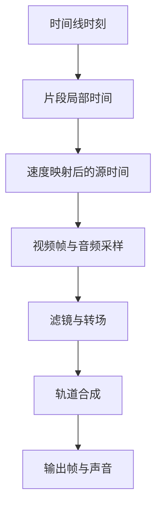

# 视频剪辑：多轨、速度与接缝

## 先理解它解决什么问题

剪辑工程保存片段如何引用素材及排列时间。素材源时间、片段局部时间和时间线时间是三个不同坐标；裁切、变速、转场与波纹操作必须在这些坐标之间保持一致。

**贯穿实例：** 删掉中间一段并使用波纹操作时，后方片段会移动；但素材源内点不应随之错误变化。撤销应恢复原始接缝和关联片段，而不是近似重排。

## 图一：三个时间坐标与一段变速片段

```fpl-canvas
video-editor
```

图例：三张卡是同一播放位置在不同坐标系中的数值，T 不是源文件时间。下方注明计算前提；变速曲线需要积分或对应映射实现，不能继续套用此恒速公式。

## 图二：从时间到音画合成



图例：方框表示时间映射、采样、效果和合成的阶段。多个轨道可以同时贡献画面与声音；流程箭头表达依赖顺序，不表示只有一条轨道。

## 实现与设计取舍

前端编辑操作维护片段身份、区间、关联和组织信息，后端项目用例负责版本和结构校验。导出先构建渲染计划，再交由共享媒体能力求值。默认效果、片段效果和转场具有不同生命周期，不能为了代码复用合并成一个不明确的状态。

## 异常、验证与当前边界

接缝测试要覆盖重叠、间隙、短片段、速度变化和精确撤销。字幕字体与缺失素材会影响结果，预检通过后仍应检查输出起止帧和声音。当前是单机编辑与渲染，不提供多机渲染农场。

## 代码入口与阅读顺序

1. `backend/app/apps/video_editor/render_plan.py`
2. `backend/app/apps/video_editor/projects.py`
3. `backend/app/capabilities/media_rendering/speed.py`

阅读时先定位输入和校验，再跟踪持久化或执行入口，最后对照输出与错误分支。可以把上方图复制到个人知识库加入自己的注释；副本不会随官方文章自动更新。
