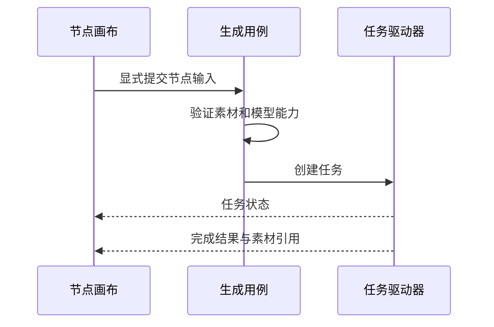

# 视觉创作工坊：节点图与生成任务

## 先理解它解决什么问题

节点画布把素材、提示和生成结果组织成可检查的关系。节点连接表达输入从哪里来，生成任务表达一次具体提交；修改画布不应悄悄重新发起收费调用。

**贯穿实例：** 图片节点连接到视频生成节点后，提交前需要确认模型支持参考图。视频完成后，结果成为受管理素材，与当次任务状态和输入来源关联。

## 图一：创作图与生成结果的生命周期

```fpl-canvas
visual-workshop
```

图例：创作节点记录意图，任务记录执行，素材记录落盘结果。右侧的已有素材可再次用作输入，无箭头连线表示这种复用关系；结果必须先托管，临时供应商 URL 不能当作持久素材。

## 图二：生成请求与结果反馈



图例：箭头表示输入到执行再到呈现的过程。模型能力校验先于任务提交；完成反馈必须与已保存的素材引用一致，而不是仅显示供应商已接单。

## 实现与设计取舍

画布项目保存结构，操作用例负责可验证的修改，生成运行器接入统一任务驱动。供应商差异由适配器处理，画布不解释原始供应商事件。结果落盘后才能成为稳定的素材引用，临时 URL 不是长期项目数据。

## 异常、验证与当前边界

模型能力不匹配、上游素材缺失和供应商执行失败需要不同反馈。中断提交不会自动重提；对已有供应商结果优先恢复。节点图是一种创作编排，不等于可以执行任意脚本或绕过权限的工作流引擎。

## 代码入口与阅读顺序

1. `backend/app/apps/visual_workshop/operations.py`
2. `backend/app/apps/visual_workshop/generation.py`
3. `backend/app/apps/visual_workshop/generation_runner.py`

阅读时先定位输入和校验，再跟踪持久化或执行入口，最后对照输出与错误分支。可以把上方图复制到个人知识库加入自己的注释；副本不会随官方文章自动更新。
