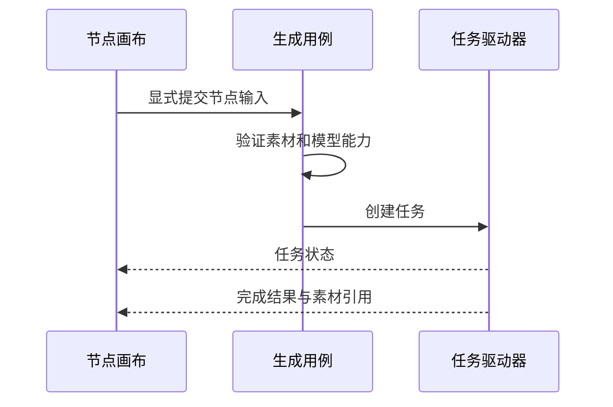
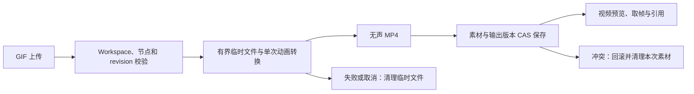
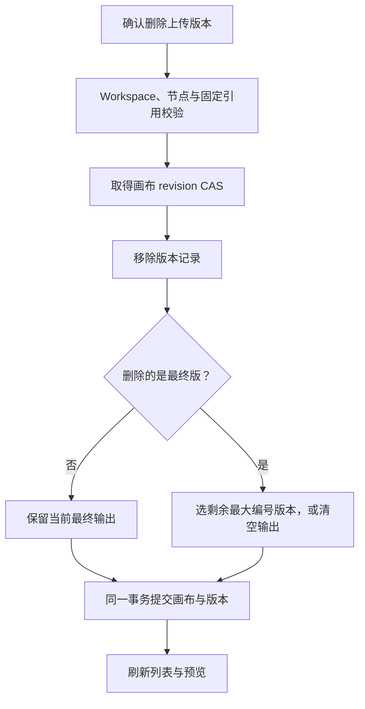
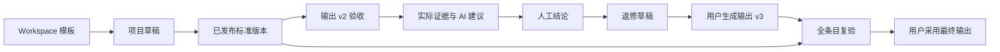

# 视觉创作工坊：节点图与生成任务

画布上已经有一个生成节点，为什么还不能把它当作完成的图片素材？节点记录创作意图，后台任务记录执行进度，结果素材才代表已经取得并托管的内容。

例如用上游文本和参考图生成一张新图：需要先组装输入并校验能力，再提交任务，最后把结果保存成可引用素材。将这三个生命周期分开，才能解释节点仍在而任务失败、任务已完成而下载尚未结束等情况。

## 创作图与生成结果的生命周期

画布节点、生成用例和素材结果之间是什么关系？

```fpl-canvas
visual-workshop
```

图例：创作节点记录意图与提示词版本，任务记录执行，素材记录落盘结果。右侧的已有素材可再次用作输入，无箭头连线表示这种复用关系；结果必须先托管，临时供应商 URL 不能当作持久素材。

例如舞蹈视频节点保留 v1 和 v2 两份文字，选中 v2 后生成：节点草稿保存两版及当前选择，提交任务冻结 v2 的实际文字，成功结果再登记为独立输出版本。切换提示词仅改变文字，模型、参考素材和参数共用；参考图片排序同步调整所有文字版本中的编号。版本与草稿使用同一画布 CAS，保存失败或冲突时不能提交；后续修改 v2 不改写已经提交的任务。节点复制与项目包保留所有提示词版本，旧草稿归一化为 v1。

图的左侧表达用户组织的输入，中央把引用转换成有效请求，右上是外部执行，右下是托管结果。已有素材可以再次作为输入，但临时供应商 URL 不能成为长期项目数据；节点出现预览也不能替代结果落盘。

节点的人工通过标记 `approved` 与任务状态独立。用户明确标记认可当前结果，保存使用原画布 CAS；新输出、不同最终版本和文本正文变更清除标记，布局与提示词编辑保留。旧客户端省略字段不会清除标记，复制节点需重新确认。

## 生成请求与结果反馈

一次生成从输入流到结果时，哪些阶段应该分别反馈给用户？



图例：箭头表示输入到执行再到呈现的过程。模型能力校验先于任务提交；完成反馈必须与已保存的素材引用一致，而不是仅显示供应商已接单。

输入校验失败意味着还没有形成有效请求；供应商执行失败意味着任务已经进入另一阶段；结果保存失败则需要检查已有结果是否可恢复。把这些错误都称为“节点坏了”，会让用户无法选择正确的下一步。

看板从任务与图片批次快照推导当前节点的运行状态，右侧以紧凑状态栏显示阶段、已用时和真实进度，各处运行图标转圈；未知进度使用不定值动画，未完成时不把 100% 当作成功落盘。供应商适配层将队列、任务账本与任务身份匹配的实时事件归一化为 `execution_info`，驱动器通过短事务持久保存。队列位置、执行节点、采样步数、上游报告值和更新时间分开呈现；采样百分比只表示当前节点，过期或断线时恢复等待动画。实时连接由各执行器拥有，只连接应用独立提交的客户端身份，断线退回 HTTP 查询；完成仍以结果下载并落盘为准。当前公共接口不提供中间帧，无输出时显示等待画面；已有输出版本继续独立预览并标明版本，不用参考素材充当生成过程。任务完成或失败后轮询结束运行状态，原有输出历史仍按最终版本规则更新，界面不持久化动画或计时。

## 节点图表达创作关联，任务负责执行事实

保存画布与提交生成是不同操作。修改节点标题、位置或文本可以形成项目修改，但不应自动重放一个收费请求。提交时应使用明确的输入快照和模型能力，避免等待过程中上游变化悄悄改变已提交的含义。

生成运行部分复用公共 GenerationTaskDriver，各应用钩子负责自己的任务存取、素材组装和结果呈现。统一状态规则尤其保证 submitting 中断不会自动重提。

## 从已有结果继续，而不是盲目重新生成

先检查上游素材是否可访问、模型是否支持输入，再核对任务身份和错误阶段。有供应商任务 ID 或结果地址时，优先沿正式恢复入口判断已有工作；需要新生成时由用户明确提交。

画布是一种创作组织方式，不是任意脚本执行器，也不是跨应用读写数据库的后门。生成能力依赖相应模型配置、网络与权限，普通画布编辑不代表这些依赖都已验证。

> [!TIP]
> 排查一张生成图时，同时记录节点 ID、任务 ID 与结果素材 ID。它们分别指向意图、执行和产物，不应相互替代。

## 图形编辑与生成请求各有确认点

前端画布编辑节点和连线，operations 维护创作图规则，generation 组装有效模型输入，generation_runner 与公共驱动器处理执行。位置和文本属于工程，任务阶段与结果素材属于后台记录；节点被选中或播放器打开不应触发新的模型请求。

一次图片生成先读取明确输入与能力，校验参考素材，再创建任务。供应商接单后得到任务身份，完成后下载并托管结果，页面关联实际结果素材。工程随后继续编辑不改变已经提交的输入，也不表示原任务需要再次收费执行。

## 节点、任务和素材的独立验收

看板上传时可先指定分类与分组，例如把两张人设图一起上传到「人设 / 主角」。前端逐文件提交并使用前一份结果的最新 revision，服务端先校验目标分类和分组，再将文件、节点归类与首个输出版本在同一 CAS 事务内保存。目标无效或 revision 冲突时拒绝本次上传；批量中已完成的文件保留，后续不自动重试。分类是画布文档的逻辑组织，不改变素材文件的物理存储目录。

视频节点上传 GIF 时，为什么仍能使用视频预览、取帧与下游引用？下面的上传流程图说明格式归一化和持久化的边界。



图例：转换在数据库写事务前完成，GIF 的每帧停留时长包含最后一帧，循环次数不展开。保存后的素材类型仍是视频，图片节点则保留原 GIF；因此不需要让下游把图片文件当作视频播放。透明区域合成为黑色，奇数画布补齐到偶数。公共媒体渲染能力拥有 FFmpeg 编码、大小／时间边界与取消清理，视觉工坊拥有上传校验、临时输入和输出登记；转换结束后仍由原 CAS 检查并发修改，不覆盖新编辑。

删除人工上传的最终版本时，怎样保持节点、历史和引用一致？例如视频 v2 上传有误，删除后可以恢复 v1；只剩 v2 时删除则清空输出。下图说明删除边界。



图例：固定引用必须先解除，CAS 冲突不会自动重放删除。恢复版本同时更新 `is_final`、节点最终版本和素材引用；删空后仍保留 `output_sequence`，下次上传不复用编号。托管文件、已提交任务与输入快照不随版本删除，跟随引用在下次提交时重新解析；非上传来源的最终版仍受删除保护。

检查修改节点不会自动生成、非法模型能力在提交前拒绝、submitting 中断不重提、下载失败保留已有结果依据，以及结果能授权读取并再次输入。生成节点、任务 ID 和素材 ID 都应能追到明确对象；仅在画布显示一张预览不能证明最终文件和记录一致。

## 相关阅读

- [后台任务与恢复](/apps/thought-workshop/official-knowledge-bases/technical/documents/tasks)
- [供应商适配与流式推理](/apps/thought-workshop/official-knowledge-bases/technical/documents/providers)
- [视觉创作工坊：主要操作流程](/apps/thought-workshop/official-knowledge-bases/visual-workshop/documents/workflow)
- [前端组件与状态分工](/apps/thought-workshop/official-knowledge-bases/technical/documents/frontend-design)

## 代码入口

1. `backend/app/apps/visual_workshop/operations.py`
2. `backend/app/apps/visual_workshop/generation.py`
3. `backend/app/apps/visual_workshop/generation_runner.py`

## 验收标准与创作结果分开保存

内置验收模板仅保留“动作迁移”，列出输出规格、角色外观、动作与道具以及人工确认的动作连贯与节奏。模板只提供角色基准图、原动作视频的参考位置，项目使用后再绑定素材；已有 Workspace 模板与项目标准独立保留。

以同一镜头的 v2 返修为例：项目标准先发布固定版本，验收记录绑定 v2、该标准以及参考素材；AI 辅助只返回带证据的建议，人工决定单项及整体结论。返修草稿保存为新的提示词版本后，用户手动提交生成 v3，复验创建新记录而不改写 v2。



图例：模板提供参考位置，不携带私人素材。强制模式的新结果保留为候选，最终输出与节点通过均由后端检查，画布 JSON 不拥有验收记录。视频是抽帧辅助检查，连续动作和音频需要人工确认，首版没有跨镜头组分析。
