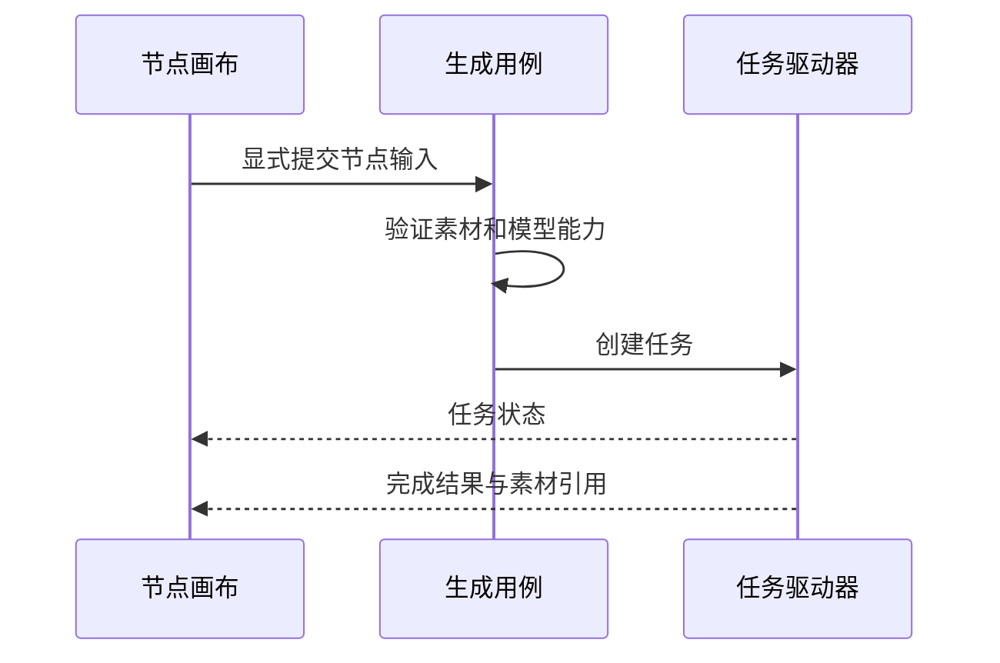

# 视觉创作工坊：节点图与生成任务

画布上已经有一个生成节点，为什么还不能把它当作完成的图片素材？节点记录创作意图，后台任务记录执行进度，结果素材才代表已经取得并托管的内容。

例如用上游文本和参考图生成一张新图：需要先组装输入并校验能力，再提交任务，最后把结果保存成可引用素材。将这三个生命周期分开，才能解释节点仍在而任务失败、任务已完成而下载尚未结束等情况。

## 创作图与生成结果的生命周期

画布节点、生成用例和素材结果之间是什么关系？

```fpl-canvas
visual-workshop
```

图例：创作节点记录意图，任务记录执行，素材记录落盘结果。右侧的已有素材可再次用作输入，无箭头连线表示这种复用关系；结果必须先托管，临时供应商 URL 不能当作持久素材。

图的左侧表达用户组织的输入，中央把引用转换成有效请求，右上是外部执行，右下是托管结果。已有素材可以再次作为输入，但临时供应商 URL 不能成为长期项目数据；节点出现预览也不能替代结果落盘。

## 生成请求与结果反馈

一次生成从输入流到结果时，哪些阶段应该分别反馈给用户？



图例：箭头表示输入到执行再到呈现的过程。模型能力校验先于任务提交；完成反馈必须与已保存的素材引用一致，而不是仅显示供应商已接单。

输入校验失败意味着还没有形成有效请求；供应商执行失败意味着任务已经进入另一阶段；结果保存失败则需要检查已有结果是否可恢复。把这些错误都称为“节点坏了”，会让用户无法选择正确的下一步。

## 节点图表达创作关联，任务负责执行事实

保存画布与提交生成是不同操作。修改节点标题、位置或文本可以形成项目修改，但不应自动重放一个收费请求。提交时应使用明确的输入快照和模型能力，避免等待过程中上游变化悄悄改变已提交的含义。

生成运行部分复用公共 GenerationTaskDriver，各应用钩子负责自己的任务存取、素材组装和结果呈现。统一状态规则尤其保证 submitting 中断不会自动重提。

## 从已有结果继续，而不是盲目重新生成

先检查上游素材是否可访问、模型是否支持输入，再核对任务身份和错误阶段。有供应商任务 ID 或结果地址时，优先沿正式恢复入口判断已有工作；需要新生成时由用户明确提交。

画布是一种创作组织方式，不是任意脚本执行器，也不是跨应用读写数据库的后门。生成能力依赖相应模型配置、网络与权限，普通画布编辑不代表这些依赖都已验证。

> [!TIP]
> 排查一张生成图时，同时记录节点 ID、任务 ID 与结果素材 ID。它们分别指向意图、执行和产物，不应相互替代。

## 相关阅读

- [后台任务：提交中断与结果恢复](/apps/thought-workshop/official-knowledge-bases/technical/documents/tasks)
- [供应商适配与流式推理](/apps/thought-workshop/official-knowledge-bases/technical/documents/providers)
- [视觉创作工坊：主要操作流程](/apps/thought-workshop/official-knowledge-bases/visual-workshop/documents/workflow)

## 代码入口

1. `backend/app/apps/visual_workshop/operations.py`
2. `backend/app/apps/visual_workshop/generation.py`
3. `backend/app/apps/visual_workshop/generation_runner.py`
